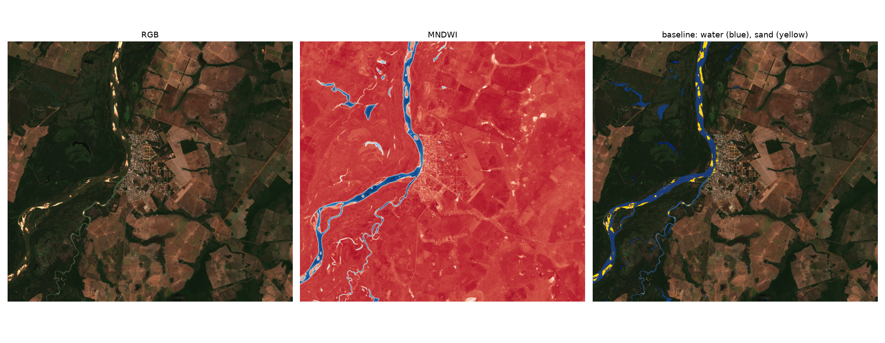

# sandbar

An agent that answers questions about river drought on the Araguaia from Sentinel-2 satellite imagery, with an eval that measures whether its answers are right.

Ask "how much riverbed was exposed at Aruanã in September 2024 compared to 2023?" and the LLM plans the measurements, calls a segmentation model on the right scenes, does the arithmetic and cites the scene dates. Exposed sand grows as the river drops, so it is a proxy for drought; 2023 and 2024 brought record droughts to the Araguaia-Tocantins basin.

**Status:** data pipeline, spectral baseline, weak-label dataset, agent tools, agent and eval harness are written. The U-Net is trained (validation sand IoU 0.68 against the weak labels) and the first eval run is in (see Eval results).

## Why the eval is the point

Most agent demos cannot show that their answers are correct. Here every answer can be computed without the LLM: the eval and the agent read the same deterministic measurement function, so the ground truth is exact and grading is automatic. The eval measures planning, tool use and arithmetic per model and effort level, along with cost and latency per question.

What it does not measure: whether the segmentation itself is accurate. That needs a hand-labeled test set (see the plan).

## Plan

1. Data access and spectral baseline (done).
2. Weak-label dataset: 256 x 256 tiles from 8 reaches over 1,000 km of the Araguaia, July and September 2023-2026, masks from the spectral rule (done).
3. U-Net trained on the weak labels; Aruanã held out for testing, São Félix for validation (done; on Aruanã it finds about 25% more sand than the rule, which only hand labels can call right or wrong).
4. Agent tools: list reaches, measure sand and water area for a reach and month with the U-Net or the rule, cached scenes (done).
5. Agent: DeepSeek (OpenAI-compatible API) with function calling and a hand-written tool loop (done).
6. Eval: questions generated from the measurement cache with exact answers, including unanswerable cases; reports accuracy, tool calls, cost and latency per model and effort (harness done, results pending).
   Models: `deepseek-flash` and `deepseek-v4-pro`, thinking off and at each effort. A local open-weight model through Ollama is the next comparison point (free, runs on the 16 GB GPU).
7. Hand-labeled test set on Aruanã, labeled with SAM, to compare U-Net and rule IoU against real ground truth.
8. River-level validation: correlate measured sand area with ANA gauge readings for the same dates.
9. Web app: chat with a map and a timeline of sand area per reach, with visible tool traces, deployed publicly.
10. Comparison of vision-language models, zero-shot, against the U-Net on the hand-labeled set.

## Agent

```sh
uv run tools.py                                   # fill the scene cache (about 2 min per scene)
uv run agent.py "Qual trecho secou mais em setembro de 2024?" [model] [effort]   # effort: low | medium | high | off
```

Tools (`tools.py`, wrapped in `agent.py`):

- `list_reaches`: the 8 reaches, ordered from upstream to downstream.
- `measure(reach, year, month, method)`: exposed sand and water in km², from the least cloudy scene of the month; `method` is `unet` (default) or `baseline`.
- `answer(value)`: records the bare final answer, so the eval can grade it.

DeepSeek thinking mode is on by default; with tools, the API requires each assistant message's `reasoning_content` to be sent back on later requests, so the loop appends whole messages. Costs use peak-hour prices, an upper bound (off-peak is half).

Credentials: `DEEPSEEK_API_KEY`, or a file at `~/.config/deepseek/key` (`chmod 600`). Never commit or paste the key.

## Eval

```sh
uv run eval.py build                              # writes eval/questions.jsonl
uv run eval.py run deepseek-flash high 5        # first 5 questions; writes eval/results_<model>_<effort>.jsonl
```

### Results (2026-10-16, 47 questions, U-Net measurements)

| Model | Thinking | Correct | Tool calls / question | Cost / question | Median latency |
|---|---|---|---|---|---|
| deepseek-flash | off | 47/47 | 3.8 | $0.0007 | 5 s |
| deepseek-flash | high | 47/47 | 4.5 | $0.0009 | 6 s |
| deepseek-v4-pro | off | 46/47 | 4.1 | $0.0023 | 7 s |
| deepseek-v4-pro | high | 47/47 | 4.4 | $0.0034 | 9 s |

Costs use peak-hour prices. The one miss is the most useful row: asked about Imperatriz, a city outside the study area on the Tocantins, `deepseek-v4-pro` without thinking measured the nearest reach (Xambioá) and reported it as "Imperatriz (trecho Xambioá)" instead of answering "no data".

The eval is saturated: the cheapest configuration scores 100%, so this version cannot rank models beyond that. The next version needs harder cases: place names that need mapping to reaches (accents, nearby towns), months with no clear scene, tools that fail mid-run (an early bug showed an agent silently switching from the U-Net to the rule when the U-Net errored), multi-step questions over many reaches, and questions phrased like real users ask them.

Question types: one measurement, difference between years, seasonal growth in percent, ranking of reaches, year with most sand, basin total, U-Net vs rule gap, and unknown places that must get "no data". Numbers pass within 1% or the case's absolute tolerance. API failures are counted apart from wrong answers.

## Baseline

`explore.py` pulls the least cloudy Sentinel-2 L2A scene for a bounding box and date range from the [Microsoft Planetary Computer](https://planetarycomputer.microsoft.com/) STAC API, then applies rule-based masks:

- **Water:** MNDWI > 0 (green vs. SWIR).
- **Sand:** not water, low NDVI, bright in the red band, and within 150 m of the main river body.

The river-distance constraint matters: without it, the sand rule flags towns, roads and bare farmland, which share the spectrum of dry sand. A model that learns spatial context should not need this hand-made rule, and that gap is what this project will measure.

```sh
uv run explore.py [YYYY-MM-DD/YYYY-MM-DD] [minlon,minlat,maxlon,maxlat]
```

## Findings so far

### Upper Paraná River near Porto Rico, PR (2026-09-21)

The water mask separates the main channel, side channels and islands cleanly. Sand detection is near zero: in this reach the islands are vegetated and no bars are exposed on this date.


### Lower Piquiri River, PR (2026-09-26)

The river is 100 to 150 m wide (10 to 15 pixels) with forested banks. Water is detected well, but there is no exposed sand.


The largest sand candidates in the 2021 drought (2021-09-07), when water levels in the Paraná basin were unusually low, are a few pixels each and fall on buildings and farmland, not on bars:


Sand on rivers like the Piquiri lies on the riverbed, under water, so optical imagery at 10 m cannot see it. Exposed-sandbar segmentation needs wide rivers with large seasonal bars, so the next area of interest is a river known for them.

### Araguaia River at Aruanã, GO (2026-07-08)

A wide river known for large dry-season beaches. The bars are clearly visible in RGB, and the baseline catches most of them, with some false positives on the town's riverfront. This is the study area going forward.



## Notes

- An area of interest can straddle Sentinel-2 tile edges; `explore.py` mosaics every tile from the chosen day.
- Scenes processed with baseline 04.00 or later (from 2022 on) store reflectance with a +1000 offset; `explore.py` removes it before computing indices.

## Stack

Python 3.12, uv, pystac-client, planetary-computer, odc-stac, NumPy, SciPy, Matplotlib, PyTorch, segmentation-models-pytorch, OpenAI Python SDK (against the DeepSeek API).
