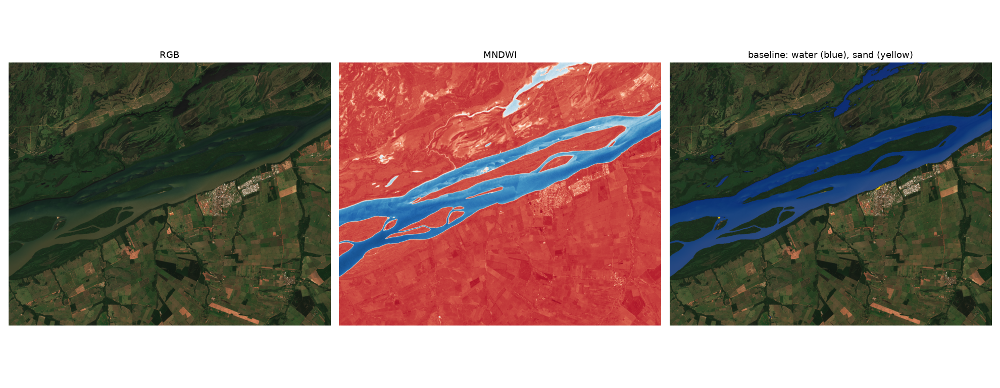
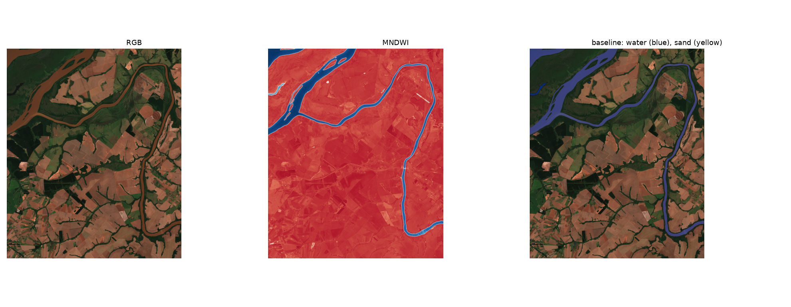
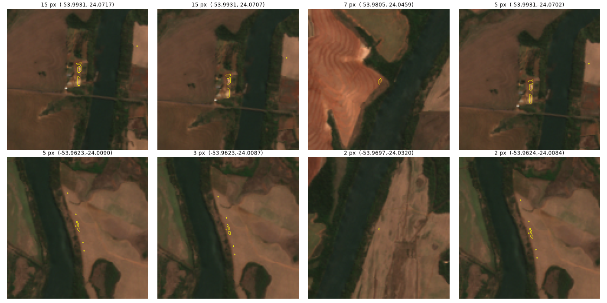

# sandbar

Segmentation of exposed river sandbars in Sentinel-2 imagery, trained on weak labels from spectral indices and compared against a spectral baseline.

**Status:** early exploration. The data pipeline and spectral baseline work; no model trained yet.

## Plan

1. Data access and spectral baseline on one area of interest (done).
2. Weak-label dataset: image tiles with masks generated from spectral indices.
3. Train a segmentation model (U-Net / SegFormer), hand-label a small test set and compare IoU against the baseline.
4. Time-series demo: interactive map showing sandbars appearing and disappearing across the dry season.

## Baseline

`explore.py` pulls the least cloudy Sentinel-2 L2A scene for a bounding box and date range from the [Microsoft Planetary Computer](https://planetarycomputer.microsoft.com/) STAC API, then applies rule-based masks:

- **Water:** MNDWI > 0 (green vs. SWIR).
- **Sand:** not water, low NDVI, bright in the red band, and within 150 m of the main river body.

The river-distance constraint matters: without it, the sand rule flags towns, roads and bare farmland, which share the spectrum of dry sand. A model that learns spatial context should not need this hand-made rule, and that gap is what this project will measure.

```sh
uv run explore.py [YYYY-MM-DD/YYYY-MM-DD] [minlon,minlat,maxlon,maxlat]
```

## Findings so far

### Upper Paraná River near Porto Rico, PR (2026-09-21)

The water mask separates the main channel, side channels and islands cleanly. Sand detection is near zero: in this reach the islands are vegetated and no bars are exposed on this date.



### Lower Piquiri River, PR (2026-09-26)

The river is 100 to 150 m wide (10 to 15 pixels) with forested banks. Water is detected well, but there is no exposed sand.



The largest sand candidates in the 2021 drought (2021-09-07), when water levels in the Paraná basin were unusually low, are a few pixels each and fall on buildings and farmland, not on bars:



Sand on rivers like the Piquiri lies on the riverbed, under water, so optical imagery at 10 m cannot see it. Exposed-sandbar segmentation needs wide rivers with large seasonal bars, so the next area of interest is a river known for them.

## Notes

- Scenes processed with baseline 04.00 or later (from 2022 on) store reflectance with a +1000 offset; `explore.py` removes it before computing indices.

## Stack

Python 3.12, uv, pystac-client, planetary-computer, odc-stac, NumPy, SciPy, Matplotlib.
